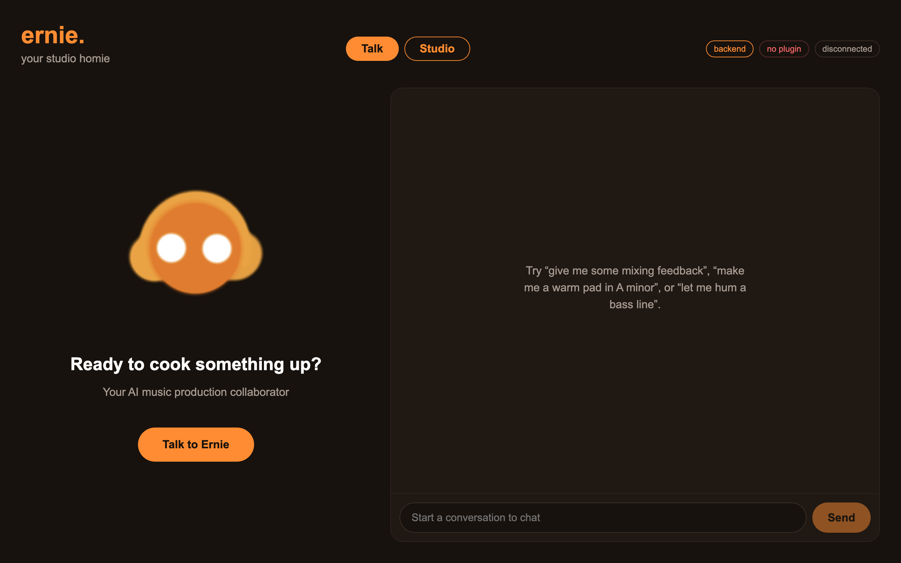

# Ernie, your personal mixing buddy



Originally built for **Hacktoberfest Hack Day New York City x Tech@NYU Buildathon: Shipyard**.

🏆 **1st place winner, ElevenLabs Voice AI track.** See the [MLH submission](https://www.mlh.com/events/hacktoberfest-2026-new-york-city/submissions/01a16f63-35b7-b157-3f01-3931d74b9ebc).

> The MLH page doesn't list the team members. Ernie was created by Rishi Krishnan, Kristyn Cho, Romy Park, and Silas Wang.

### Meet Ernie

Bernerd “The Hit Maker” Victor Wegman, or simply “Ernie”, is a voice in my head that does not leave me alone until I make good music. It is tuned to talk in an emotionally engaging manner and offer genuine feedback on your musical creative endeavor.

He earned a PhD in Hustling from GrammyU and successfully defended his dissertation on “musonomics: the economic viability of the creative process” in front of a board of industry professionals and esteemed researchers from academia ranging from basket-weavers, electrical engineers, recording engineers, and customer support representatives.

His diverse educational, entrepreneurial, and philanthropic background has proven to create hits. Some of the artists that he frequently collaborates with include.

---

# ERNIE / Foldback

## ERNIE at a glance

ernie reads the session (AbletonOSC + JUCE capture), builds with you (Stack: library picks by key/tempo, ElevenLabs Sound Effects + Music generation, hum→MIDI), and critiques (mixengine measurements, rule-based notes spoken via TTS). Talk to it through the ElevenLabs Agent in the React/Electron app (see **Run Ernie** below); the original web UI with Scribe + TTS is the Studio tab.

### Run

**Backend + web UI** (port 8000)

```sh
python3.13 -m venv .venv && source .venv/bin/activate   # Python 3.10+
pip install -r requirements.txt
cp .env.example .env   # ELEVENLABS_API_KEY, SAMPLE_DIRS, OUT_DIR=./demo/generated (demo cache)
uvicorn app:app --reload --port 8000
```

**JUCE plugin** — build with CMake (see `plugin/README.md`); its loopback API listens on `127.0.0.1:17831`. Then:

```sh
curl -X POST http://127.0.0.1:8000/tracks/register -H 'Content-Type: application/json' \
  -d '{"instance_id":"master","name":"Master","role":"master"}'
curl -X POST http://127.0.0.1:8000/tracks/master/plugin-listen -H 'Content-Type: application/json' \
  -d '{"plugin_port":17831,"minimum_context_seconds":2,"max_duration_seconds":15,"playback_start_timeout_seconds":30}'
curl -X POST http://127.0.0.1:8000/mix/analyze -H 'Content-Type: application/json' \
  -d '{"capture_ids":["<capture_id from plugin-listen>"]}'
```

**React/Electron UI** (port 5173, `strictPort`)

```sh
scripts/dev.sh     # backend + Vite + Electron; see "Run Ernie (voice app)" below
```

The API key stays in the root `.env`; the UI gets a signed conversation URL from the backend. Never put the ElevenLabs API key in the UI.

### Feature status

| Feature | Verified by | Status |
|---|---|---|
| Stack picks / preview | human | working |
| Hum → MIDI | human | working |
| Sound Effects + Music generation, cached | real API | working |
| TTS mix notes | real API | working |
| Plugin capture + `/mix/analyze` | real capture | working |
| Ableton session read | mock | mock only |
| Stack hum-with-metronome, Play stack, Regenerate by voice | machine (synthetic audio, stubs) | machine-tested |
| Calibration / beatbox | — | in progress |
| Agent voice + client tools (listen, generate, samples, hum, session) | human (connect, generate); machine (listen flow vs fake plugin) | working |
| Electron dev window | human | working |
| Electron packaged `.app` | — | not done (`npm start` runs the production build) |

### ElevenLabs usage

| API | Used by |
|---|---|
| TTS | `/advise`, `/advise/captures`, `/ask` |
| Scribe | `/ask`, `/revise` |
| Music | `/compose`, `/stack/pregen` |
| Sound Effects | `/generate/oneshot` |
| Agents | `ernie-ui` (voice conversation + client tools) |

Handoffs: `docs/HANDOFF-midi-samples-stack.md`, `docs/HANDOFF-backend-juce.md`, `docs/INTEGRATION-HANDOFF.md`.

Recording copies the track into a stereo RAM ring and leaves the live buffer alone. A mono bus is duplicated into the right channel. While it is armed, sample rate and buffer duration cannot change, and the gain parameter is not applied. The ring holds the last N seconds at the chosen capture rate (22.05–192 kHz, or match host). The cap is 256 MB.

Local music-production collaborator: Ableton session context, mix analysis, voice, MIDI and sample tools, plus a JUCE plugin that can capture a track into a bounded RAM buffer.

## Run Ernie (voice app)

Ernie is a voice agent: talk to it and it listens to your mix through the plugin, generates sounds, finds samples
and turns hums into MIDI, all from one chat-style window.

```sh
python3.13 -m venv .venv                     # Python 3.10+ (app.py uses `X | None` annotations)
.venv/bin/pip install -r requirements.txt
brew install ffmpeg                          # browser audio is webm; hum-to-MIDI decodes it with ffmpeg
cp .env.example .env                         # set ELEVENLABS_API_KEY (sk_...) and ELEVENLABS_AGENT_ID
.venv/bin/python scripts/setup_agent.py      # once: gives the Ernie agent its prompt and client tools
scripts/dev.sh                               # backend :8000 + Vite :5173 + Electron window
```

Put the ERNIE plugin on the master bus. Click **Talk to Ernie**, then for example:

- "Give me some mixing feedback": Ernie says "I'm listening, run the track", arms the plugin; press play. When the capture finishes it reads the measured notes back, or tells you to keep cooking if there's nothing to fix.
- "Make me a warm pad in A minor at 120": generates an 8 s loop (drums/FX: a one-shot) and posts a player in the chat.
- "Find me a bass sample": ranks your `SAMPLE_DIRS` library by tempo then key.
- "Let me hum a bass line": plays a count-in, records, and returns a `.mid` (and a new MIDI track in Live).

The header chips show whether the backend is up, which port the plugin answered on, and the agent connection. You can type to Ernie in the chat box too.

How it fits together: the ElevenLabs Conversational Agent (its built-in LLM, Ernie's prompt and voice) calls **client tools** that run in the React app (`ernie-ui/src/hooks/useErnieTools.js`), which call this backend. The agent never reaches the plugin or Ableton directly, and the API key stays in `.env`: the app gets a short-lived signed URL from `GET /agent/signed-url`. See `docs/ARCHITECTURE.md`.

`cd ernie-ui && npm start` builds the UI and opens Electron against the build served by FastAPI at `/app`. The original button UI is still at `http://127.0.0.1:8000/` and the OpenAPI docs at `/docs`.

## Mix analysis API

The analysis API is implemented in `mixengine/` and is served alongside the Foldback routes at the root path.

1. `POST /tracks/register` with `{"instance_id":"lead-vocal","name":"Lead","role":"vocal"}` to create the analysis track.
2. Select the plugin's loopback port shown in its editor, then call `POST /tracks/{id}/plugin-listen` with `{"plugin_port":17831,"minimum_context_seconds":10,"max_duration_seconds":60}`.
3. The service handshakes with that specific plugin, arms capture, and returns `202` with a capture ID. The plugin waits for DAW playback, records until transport stops or its configured duration is reached, and writes a WAV cache file.
4. The service detects completion, opens the WAV cache file named for that exact plugin session, runs DSP, stores mixing notes on the capture, and removes the temporary cache. `GET /captures/{capture_id}` reports status, measurements, and the mixing notes for that listen. `GET /tracks` returns latest measurements and staleness. `POST /mix/analyze` ranks those notes across the current window, including level, crest factor on transient roles, polarity, and relative band balance. A bright capture on its own is not treated as an EQ problem.

The direct plugin endpoints are also available after `POST /v1/handshake`: authenticated `POST /v1/listen`, `GET /v1/status`, and `GET /v1/capture.wav`. The FastAPI bridge polls the plugin and handles the WAV upload/analysis path automatically. Plugin listen duration is capped at 120 seconds by its RAM ring; playback start timeout defaults to 120 seconds and can be set with `playback_start_timeout_seconds`.

`GET /health` returns service status. `POST /tracks/{id}/listen` and `GET /tracks/{id}/listen` remain available for clients that manage plugin polling themselves; `POST /captures/{id}/cancel` cancels a request. Mono/stereo PCM WAV is supported; malformed WAVs, unsupported channel counts and oversized/duration-limited captures receive explicit errors. Analysis measures peak and RMS dBFS, crest factor, band energy and stereo correlation. A high band level alone does not imply an EQ problem. Stale captures are identified and excluded from current-mix recommendations.

## JUCE plugin

`source/` contains the JUCE plugin. Build with CMake (JUCE 9.0.4 is fetched by default). The plugin has a loopback-only control API on `127.0.0.1:17831` (scans through port 17862 if occupied). `POST /v1/handshake` returns the per-instance token; send it as `X-Ernie-Token` to control endpoints. `GET /v1/status` reports capture state. See `plugin/README.md` and `docs/ARCHITECTURE.md` for the current plugin API and build details.

The plugin retains manual `/v1/recording/start` and `/v1/recording/stop` controls. Agent listen captures use transport gating, and completed WAVs are cached under `~/Documents/ernie/captures/` until retrieved over the authenticated loopback API.

## Other features

Foldback routes provide Ableton session context, structural/spectral mix notes, speech interaction, hum-to-MIDI, sample matching, and music composition through ElevenLabs. Finished plugin listens are included: `POST /advise` adds their notes to the session notes, `POST /advise/captures` speaks them without Ableton, and `/tools/track_analysis/{label}` reads a plugin capture by track id, name, or role. Set `FOLDBACK_MOCK=1` to use `foldback/session.mock.json` without Ableton. See `docs/ARCHITECTURE.md` for component ownership and route details.

**Stack tab.** Builds a track one layer at a time: Drums, Bass, Pad, Synth/Lead, FX, Vocals. Header shows session tempo and a key, set from the chosen sample's filename. *Pick from library* (`GET /samples/pick?tag=&key=&bpm=`) returns up to 5 indexed samples ranked by tempo then key, with mismatches flagged. *Preview* plays the chosen file. *Generate* calls ElevenLabs Sound Effects for Drums/FX one-shots (`POST /generate/oneshot`) or the Music API for 8 s loops on tonal rows (`POST /compose`, prompt includes key and tempo). *Regenerate by voice* sends your instruction through Scribe (`POST /revise`) and regenerates. *Hum melody* plays the key as a reference tone, runs a metronome, and turns the hum into quantized MIDI on a new Live track named after the row (`POST /midi/hum`). *Play stack* loops all chosen layers together in the browser at the session tempo. Beatbox → drums is in progress.

### Demo setup

```sh
git clone <repo> && cd ernie
brew install ffmpeg
python3.13 -m venv .venv && source .venv/bin/activate && pip install -r requirements.txt
cp .env.example .env   # ELEVENLABS_API_KEY, ELEVENLABS_AGENT_ID, SAMPLE_DIRS=/path/to/samples, OUT_DIR=./demo/generated
uvicorn app:app --port 8000
curl -X POST -F force=true http://127.0.0.1:8000/samples/scan           # index the library (seconds)
curl -X POST -F key=Am -F bpm=124 http://127.0.0.1:8000/stack/pregen    # cache the demo loops
```

## Tests

```sh
python -m pytest
```
