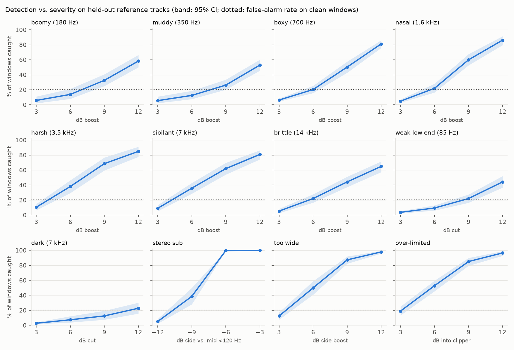
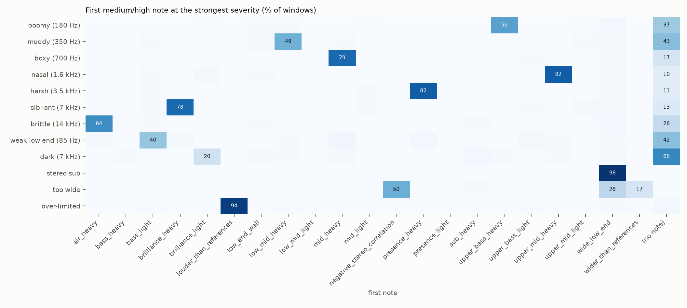

# Mix feedback engine: held-out eval

61 reference tracks, 5-fold by track, seed 0. 735 clean 15 s windows; every window also gets each problem at each severity. Brackets are 95% CIs, bootstrapped over tracks.

- **False alarm on clean masters:** 20% [16-25] of windows get a medium/high note
- **Caught, averaged over 12 problems:** 73% at the strongest severity, 54% at the second strongest
- **Top-1 (the right note first):** 63% at the strongest, 48% at the second strongest
- **Speed:** 81 ms to analyze and judge a 15 s window (185x real time, one core)

| Problem | Severity | Caught | Top-1 | 50% caught at |
|---|---|---|---|---|
| boomy (180 Hz) | 3 dB boost | 6% [2-11] | 3% [1-7] | 11 dB boost |
|  | 6 dB boost | 14% [8-21] | 12% [7-18] |  |
|  | 9 dB boost | 33% [25-41] | 30% [23-38] |  |
|  | 12 dB boost | 58% [50-67] | 56% [48-64] |  |
| muddy (350 Hz) | 3 dB boost | 6% [2-11] | 4% [1-7] | 11.7 dB boost |
|  | 6 dB boost | 13% [8-19] | 11% [6-17] |  |
|  | 9 dB boost | 26% [20-34] | 24% [18-30] |  |
|  | 12 dB boost | 53% [46-60] | 49% [41-56] |  |
| boxy (700 Hz) | 3 dB boost | 6% [4-8] | 4% [3-6] | 9 dB boost |
|  | 6 dB boost | 20% [16-25] | 17% [13-21] |  |
|  | 9 dB boost | 50% [43-58] | 47% [40-54] |  |
|  | 12 dB boost | 81% [76-86] | 78% [73-83] |  |
| nasal (1.6 kHz) | 3 dB boost | 5% [3-7] | 4% [2-6] | 8.2 dB boost |
|  | 6 dB boost | 22% [16-28] | 20% [15-25] |  |
|  | 9 dB boost | 60% [53-68] | 57% [49-64] |  |
|  | 12 dB boost | 86% [80-91] | 82% [76-88] |  |
| harsh (3.5 kHz) | 3 dB boost | 10% [6-15] | 9% [5-13] | 7.2 dB boost |
|  | 6 dB boost | 38% [29-46] | 36% [27-44] |  |
|  | 9 dB boost | 69% [60-77] | 66% [57-74] |  |
|  | 12 dB boost | 85% [78-91] | 82% [75-89] |  |
| sibilant (7 kHz) | 3 dB boost | 9% [5-13] | 8% [5-12] | 7.6 dB boost |
|  | 6 dB boost | 36% [28-43] | 35% [27-42] |  |
|  | 9 dB boost | 62% [54-70] | 59% [51-66] |  |
|  | 12 dB boost | 81% [74-86] | 78% [72-83] |  |
| brittle (14 kHz) | 3 dB boost | 5% [3-8] | 4% [2-7] | 9.8 dB boost |
|  | 6 dB boost | 22% [17-28] | 21% [16-27] |  |
|  | 9 dB boost | 44% [37-51] | 43% [37-50] |  |
|  | 12 dB boost | 65% [57-72] | 64% [57-70] |  |
| weak low end (85 Hz) | 3 dB cut | 4% [2-5] | 3% [2-5] | never |
|  | 6 dB cut | 9% [6-13] | 8% [5-12] |  |
|  | 9 dB cut | 22% [16-28] | 20% [15-25] |  |
|  | 12 dB cut | 44% [37-52] | 40% [33-47] |  |
| dark (7 kHz) | 3 dB cut | 3% [2-4] | 2% [1-3] | never |
|  | 6 dB cut | 7% [4-12] | 5% [3-9] |  |
|  | 9 dB cut | 13% [8-19] | 10% [6-16] |  |
|  | 12 dB cut | 23% [16-30] | 20% [14-27] |  |
| stereo sub | -12 dB side vs. mid <120 Hz | 5% [2-9] | 5% [2-8] | -8.4 dB side vs. mid <120 Hz |
|  | -9 dB side vs. mid <120 Hz | 38% [28-50] | 38% [28-48] |  |
|  | -6 dB side vs. mid <120 Hz | 100% [99-100] | 97% [95-98] |  |
|  | -3 dB side vs. mid <120 Hz | 100% [100-100] | 98% [97-99] |  |
| too wide | 3 dB side boost | 12% [8-17] | 7% [4-11] | 6 dB side boost |
|  | 6 dB side boost | 50% [41-59] | 30% [24-37] |  |
|  | 9 dB side boost | 87% [82-92] | 42% [34-50] |  |
|  | 12 dB side boost | 98% [96-99] | 17% [12-23] |  |
| over-limited | 3 dB into clipper | 19% [13-25] | 17% [12-22] | 5.8 dB into clipper |
|  | 6 dB into clipper | 53% [45-60] | 51% [44-58] |  |
|  | 9 dB into clipper | 85% [79-90] | 82% [77-87] |  |
|  | 12 dB into clipper | 96% [93-99] | 94% [90-97] |  |

False alarms on clean windows, by note: `air_heavy` 0.9%, `bass_heavy` 1.6%, `bass_light` 1.4%, `brilliance_heavy` 1.4%, `brilliance_light` 1.2%, `louder_than_references` 1.8%, `low_end_wall` 5.4%, `low_mid_heavy` 1.6%, `low_mid_light` 1.4%, `mid_heavy` 1.2%, `mid_light` 0.4%, `presence_heavy` 0.7%, `presence_light` 1.1%, `sub_heavy` 1.5%, `upper_bass_heavy` 0.9%, `upper_bass_light` 1.2%, `upper_mid_heavy` 0.7%, `upper_mid_light` 1.5%, `wide_low_end` 2.9%, `wider_than_references` 1.1%

